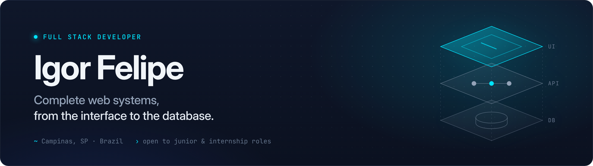
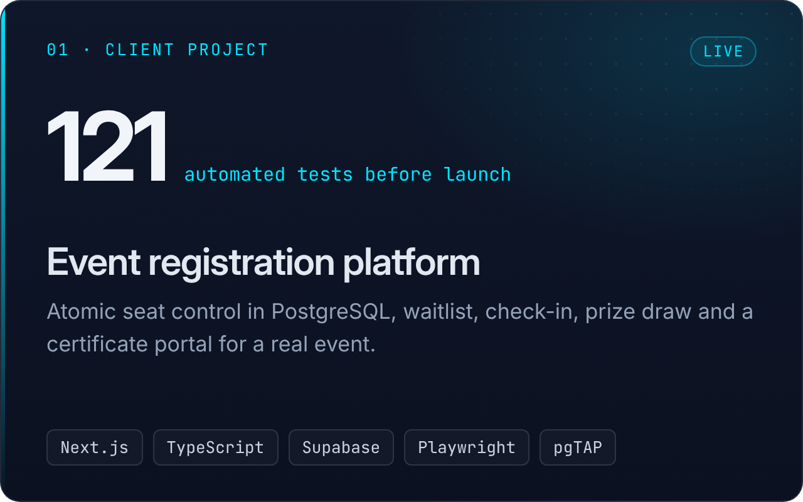
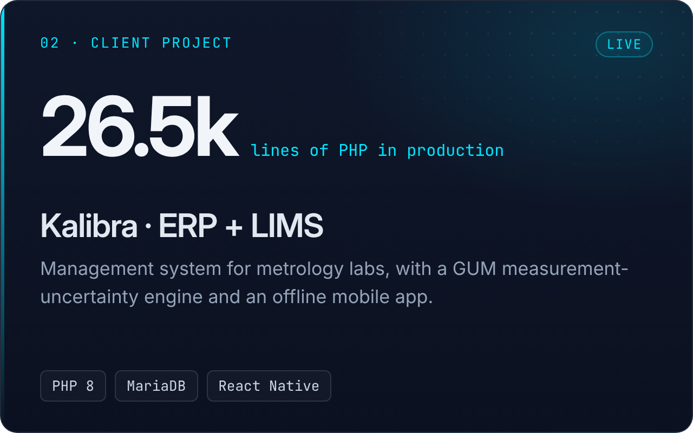
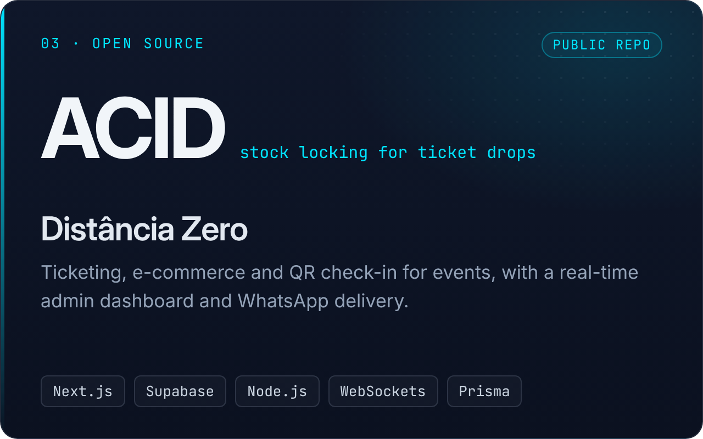
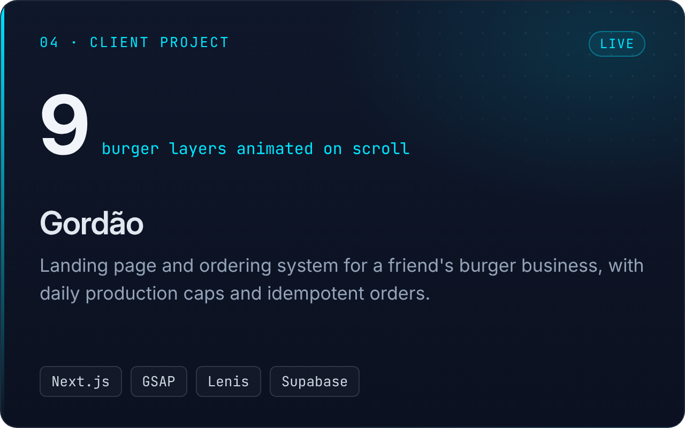
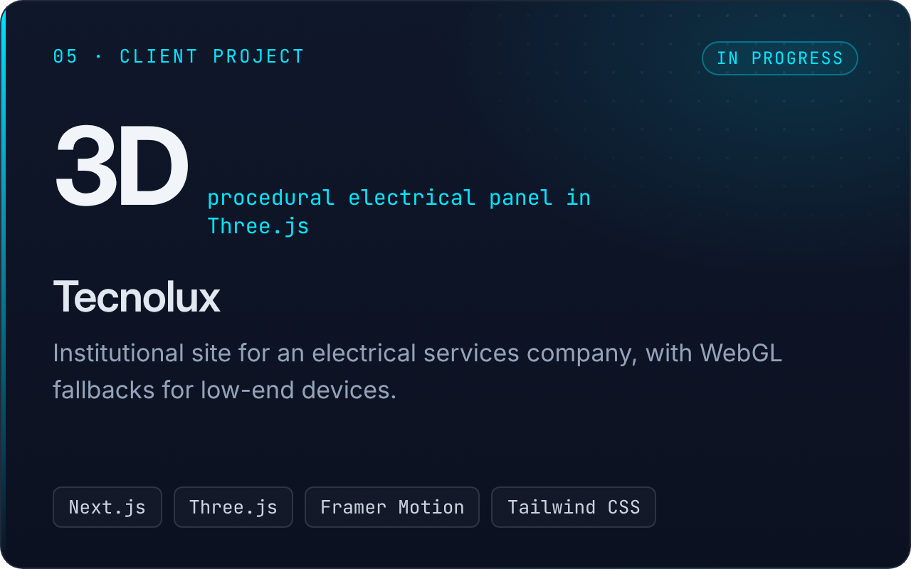
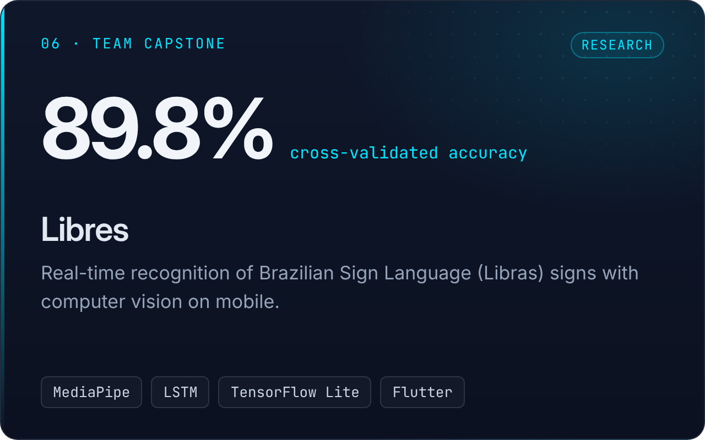

 

## `$ whoami`

I build complete web applications: interface, API, database, business rules and tests. Most of what I ship is real client work, so I care about the parts nobody sees: concurrency handled in the database, row-level security, accessibility and automated tests.

- 🛠️ **Freelance full stack developer** since March 2026, based in Campinas, SP (Brazil)
- 🧪 **Tests before launch:** Vitest, Playwright and pgTAP. My last client project shipped with 121 passing tests
- 📱 **Built for the cheapest phone**, not just my own machine: performance budgets, WebGL fallbacks and reduced-motion support
- 💡 **Self-taught**, writing code since I was 7
- 🎯 **Open to junior and internship roles**: on-site, hybrid or remote

 

## `$ ls ./featured-work`

> Most of my client work lives in private repositories. I'm happy to walk through the code in an interview.

<table>
  <tr>
    <td width="50%"></td>
    <td width="50%"></td>
  </tr>
  <tr>
    <td width="50%"></td>
    <td width="50%"></td>
  </tr>
  <tr>
    <td width="50%"></td>
    <td width="50%"></td>
  </tr>
</table>

 

## `$ cat stack.txt`

  

| Area | Tools |
| :--- | :--- |
| **Front-end** | React, Next.js, TypeScript, Tailwind CSS, GSAP, Framer Motion, Three.js |
| **Back-end** | Node.js, PHP 8, REST APIs, WebSockets, Prisma |
| **Data** | PostgreSQL, Supabase (RLS, RPCs), MySQL / MariaDB |
| **Testing** | Vitest, Playwright, pgTAP, axe-core |
| **Mobile & ML** | React Native, Flutter, MediaPipe, TensorFlow Lite |

 

  Looking for someone who ships the whole system working? <a href="https://www.linkedin.com/in/igorfdev">Let's talk on LinkedIn</a>.

